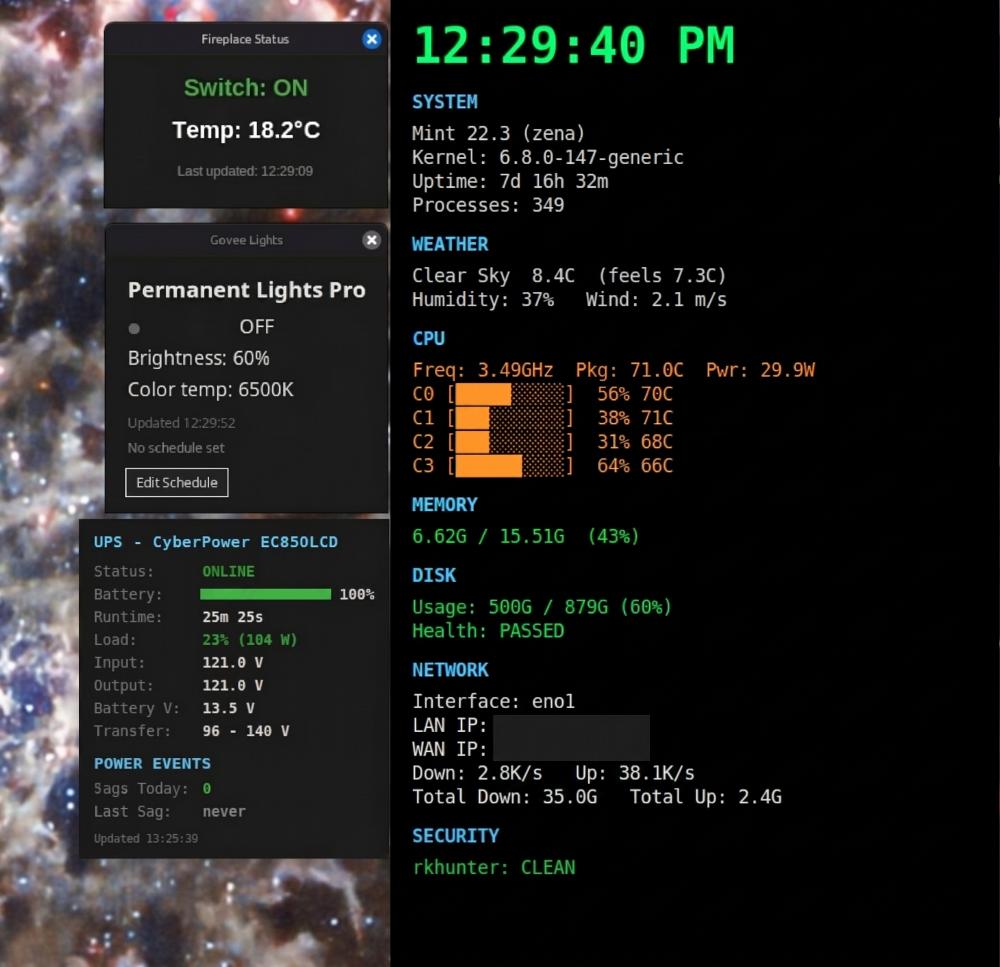

# Systems Automation & Telemetry Toolkit

A modular collection of host monitoring scripts, hardware telemetry tools, and IoT device integrations built for Linux environments.

Developed and iterated using Claude Code to provide lightweight, real-time desktop telemetry, power quality tracking, and automated device state management without heavy daemon overhead.

---

## Included Tools & Scripts

### 1. `system_monitor.py` — Host Telemetry & System Auditing
* **Kernel & Host Metrics:** Tracks kernel version, system uptime, active processes, and per-core CPU load and thermals.
* **Storage & Network Auditing:** Monitored drive capacity, filesystem health status, and live interface throughput metrics.
* **Integrity Auditing:** Integrated status reporting for `rkhunter` system checks.
* **Weather Integration:** External environmental data via OpenWeatherMap API using external configuration.

### 2. `ups_monitor.py` — Power Quality & Infrastructure Resilience
* **CyberPower UPS Integration:** Live telemetry tracking battery percentage, estimated runtime reserves, load wattage, and input/output voltages.
* **Power Event Tracking:** Monitors line transfer thresholds and logs voltage sag occurrences to protect host storage pools.

### 3. `fireplace_widget.py` — Environmental State Monitor
* Lightweight desktop widget displaying active switch state and ambient temperature readouts.

### 4. `govee_widget.py` — Smart Lighting Control
* Local control interface interfacing with Govee lighting endpoints for brightness, color temperature (Kelvin), state toggling, and scheduled events.

### 5. `shelly_webhook.py` — Webhook Event Listener
* Asynchronous listener receiving webhook event payloads from local Shelly smart relays and triggers for device automation.

---

## Design Principles
* **Read-Only / Low Footprint:** Lightweight polling designed to prevent storage lock contention or excessive CPU cycles.
* **Credential Separation:** API keys, secrets, and environment-specific configs are decoupled from source scripts.
* **Defensive Exception Handling:** Built-in network fallbacks and timeout guards for resilient continuous execution.
